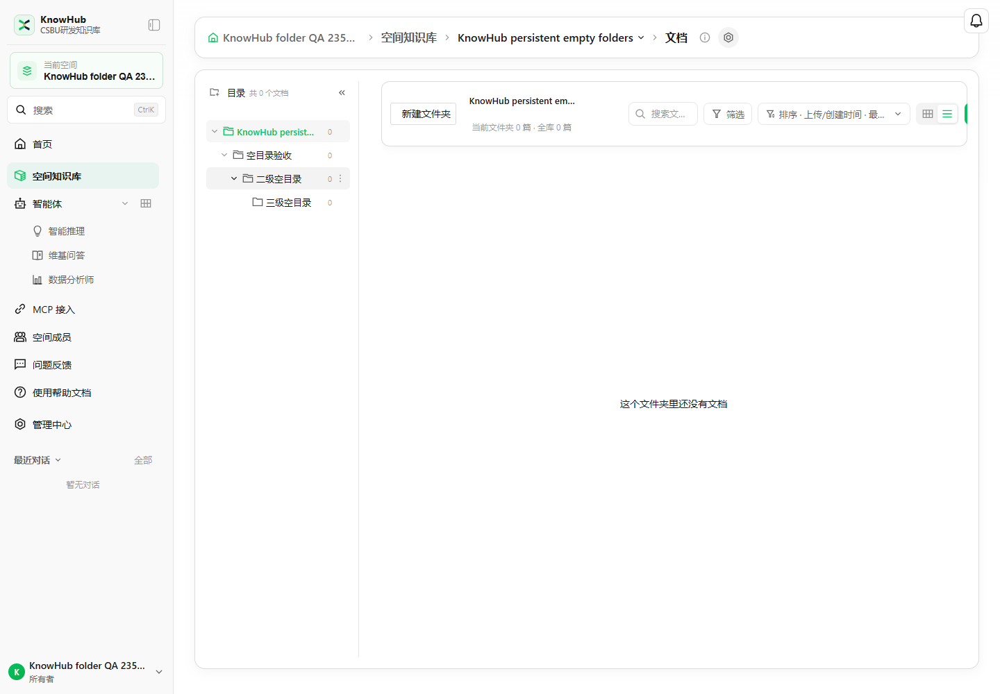
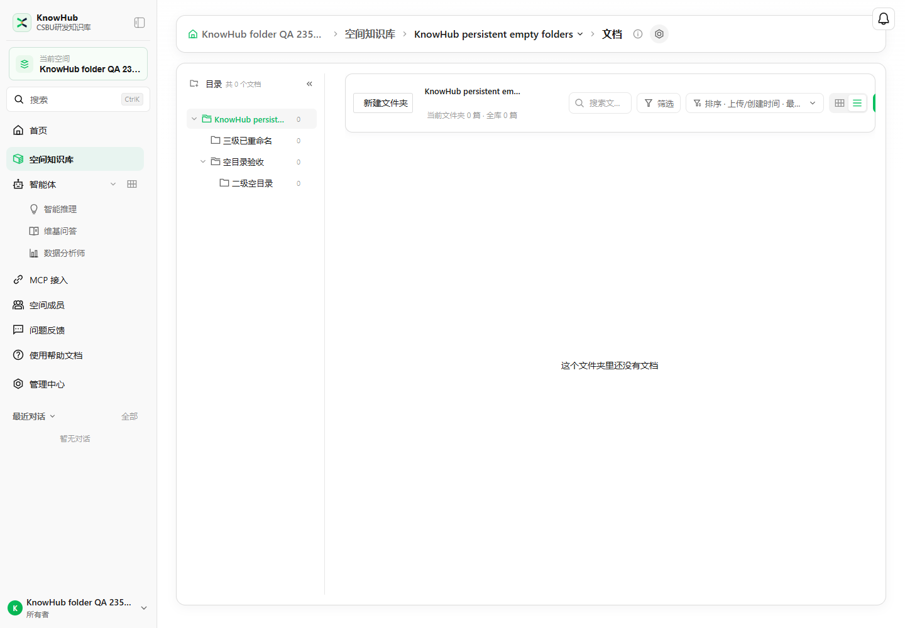
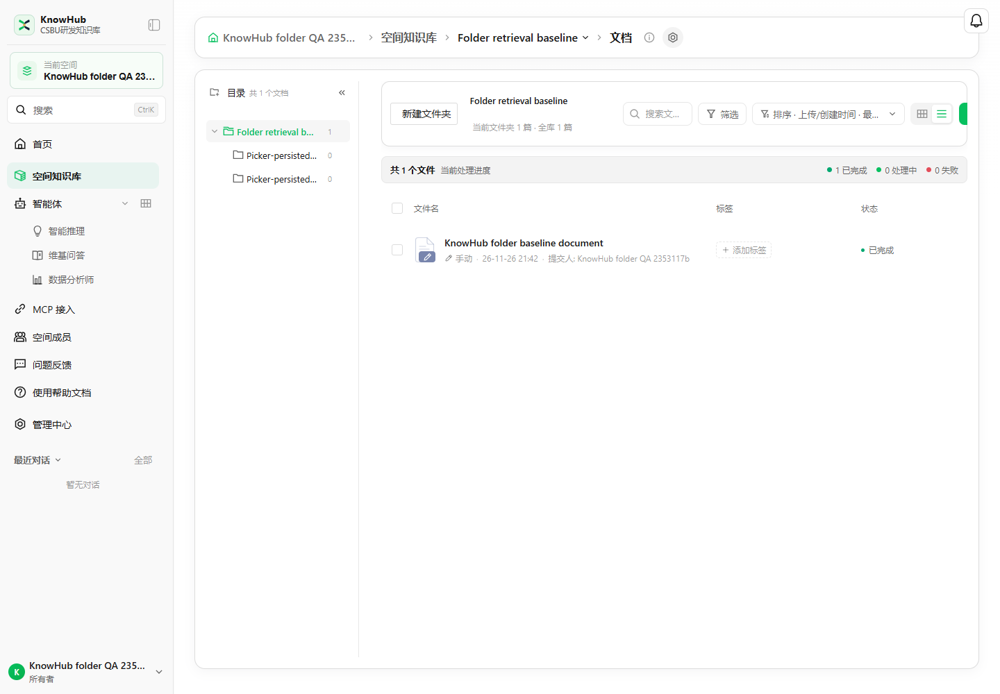

# 多级空目录：真实测试站点验收

2026-11-26。目录功能、页面、鉴权 API、数据保全和检索验收通过。**飞书真实同步仍受升级前已有的安全停止阻塞，生产未发布。**

## 版本、范围与变更

- 功能 [PR #272](https://github.com/suoak/WeKnora/pull/272) 已合入；发布源为 `642bbe7f18c4512a8623be84c385abf0862f43ec`，版本 `0.8.0-knowhub-folders-642bbe7f1`。
- [上游差异、API、迁移及回滚设计](../../knowledge-folders-knowhub.md)：复用 #5037 的轻量目录表、校验和交互；保留 `knowledges.folder_path`。未引入 `existing_folder_anchor`、替换/重解析协议或 source CAS。后台普通 Save 忽略 FolderPath 的窄变更已单独测试。
- 持久化涉及 types、repository、service、handler、路由以及 PostgreSQL/SQLite `003052`；旧 migration 未改动。页面涉及 KnowledgeBase、KbFolderTree、创建对话框和 FolderPickerMenu，并向文档卡片、列表、批量操作及上传确认传递 KB ID。
- 测试涵盖后端权限、生命周期、并发、正式迁移/回滚、真实 PostgreSQL、前端状态/组件和真实浏览器。没有新增 MCP 工具、Portal 写入口或放宽隔离环境能力。

## 实际部署目标

入口 `http://172.30.232.42`。以实际监听 80/8080 的容器及 `nginx -T` 为依据，项目为 `knowhub-feishu-v2-d6e99d894d3a`，数据库为 `knowhub_feishu_v2_test`。APP 和 Worker2 均为写进程，已一同升级，Frontend 同版发布。

早期读取了历史 `knowhub-mvp-p3` 配置，导致预期 QA 数据与库内计数不一致。该历史库未执行 migration，历史 APP 已恢复原镜像和原库运行。发现差异后重新核对运行网关，并在真实目标中确认 QA 用户、知识库和基线文档 ID，重新完成全部备份演练。下述验收仅指实际入口站点。

| 组件 | 实际镜像 ID |
| --- | --- |
| APP / Worker2 | `sha256:51637f6dc20d8876771582b6b4fc022bfc33b99fdf84fa8588f100b117e08d49` |
| Frontend | `sha256:b8fa597477215aacf6c0bd2c1934961e701a89befaa232b9181ba8d8921f7885` |

APP 和 Worker2 健康，重启计数均为 0；Frontend 静态包含提交标识。鉴权 API 实际返回完整发布 SHA，数据库为 `3052 / clean`。见 [provenance](evidence/health-provenance.json)。

保留原文件卷、staging、配置、模型、加密/签名密钥、Redis、来源、游标和权限设置。迁移由 CLI 在两个写进程正常停止后执行，启动时两进程 `AUTO_MIGRATE=false`，避免再次迁移和覆盖模型配置。同步 source SHA 与编译版本对齐，未更改来源授权或安全策略。Frontend 指向实际 APP 容器，网关仅 reload 以重新解析容器地址。

原镜像指定 `JIEBA_DICT_DIR=/app/jieba-dict`，新镜像提供模块目录。首次启动因此被拒绝；比较全部原词典文件哈希相同后，将两个进程映射到新镜像的 `/go/pkg/mod/github.com/yanyiwu/gojieba@v1.4.7/deps/cppjieba/dict`，重新创建后健康且无重启。词典内容未变，见 [兼容性回执](evidence/dictionary-compatibility.json)。

## 测试结果

| 验证 | 结果 / 证据 |
| --- | --- |
| PR 最终 CI | 20 项成功，3 项按原条件跳过；没有将跳过记为通过。[回执](evidence/final-pr-ci.json) |
| main CI | 已完成；所有检查成功或按条件跳过。[回执](evidence/final-main-ci.json) |
| PostgreSQL、前端及浏览器专用门禁 | [45820743040](https://github.com/suoak/WeKnora/actions/runs/45820743040) 成功；真实全迁移链、目录并发/回滚、41 项前端回归、类型检查及两项组件浏览器测试 |
| 飞书受管写入 / HOLD / 目录移动 | [45820742860](https://github.com/suoak/WeKnora/actions/runs/45820742860) 成功，兼容 #188、003048、003051；不等同于真实飞书在线同步成功 |
| 发布镜像 | [45824085054](https://github.com/suoak/WeKnora/actions/runs/45824085054) 成功；Frontend 曾遇 esbuild ETXTBSY，重试后成功，未改业务代码 |
| 真实站点 API | 35 项断言全部通过：[回执](evidence/live-api-acceptance.json) |
| 真实站点页面 | 创建三级空目录、刷新保留、空目录重命名和移动后再刷新；无 HTTP 错误。[回执](evidence/live-browser-acceptance.json) |
| 真实选择器 | 新建目标目录、实际移动 QA 文档、移回原处后空目录仍保留；两种检索继续命中。[回执](evidence/live-picker-acceptance.json) |

API 实测包括创建 201、重名 409、非法名称 400、父目录缺失 404；子目录或文档非空删除 409，空叶子删除 200；空目录重命名 200 且 `moved_count=0`；移动合并后路径持久化。未登录写入 401，跨空间写入 403。临时 retrieve-only Key 先通过 GET 证明认证有效，随后 POST/PUT/DELETE 均为 403，测试后已撤销。

使用正常注册 API 创建独立 QA 用户，非系统管理员，仅在自己的测试空间操作，未重置或提升现有用户。浏览器使用真实登录；引导完成偏好仅影响欢迎提示。所有截图为该用户的合成测试数据。

测试结束后将演示叶子移回三级路径，保留可复核的三级空目录；该 KB 文档数仍为 0。见 [最终目录树](evidence/final-empty-tree.json)。

## 既有数据与检索

真实目标升级前共 7 份文档，其中 1 份为本次 QA 基线。逐表比较备份副本与当前库的全部原字段，排除专门用于移动/登录测试的 QA 文档和账号后，以下数据完全相同：

- 原有 6 份文档、241 条分块、57 条向量；
- 4 个数据源、2 条飞书受管资源、5 条个人飞书导入记录；
- 3 个模型、3 个原用户及 6 个知识库。

QA 文档仅有位置及更新时间发生预期变化，已移回原位置；API 比较其余字段一致。升级前后关键词和向量检索各命中基线文档。见 [数据摘要比较](evidence/business-data-verification.json)、API 和选择器回执。

## 迁移、备份与回滚

实际执行顺序：3042 库全量备份 → 新建副本恢复验证 → 副本迁移至 3052 且原字段相同 → 检查无在途任务 → APP/Worker2 正常退出、退出码 0 → 新备份及恢复验证 → 正式迁移 → 同版统一启动 → 页面/API/检索验收。

[副本迁移](evidence/actual-migration-rehearsal.json)、[停写](evidence/drain-receipt.json)、[正式迁移](evidence/migration-verification.json) 均留有回执。备份和包含密钥的运行配置仅保存在主机私有目录 `/mnt/sata0/knowhub-feishu-v2-builds/folders-live-642bbe7f1`，目录 0700、文件 0600；未提交数据库内容或凭据。

已保存 `before-3042.dump`，并恢复为 `folders_live_rollback_642bbe7f1`；该库仍为 3042、clean，逐表原字段匹配。旧 APP/Worker2/Frontend 镜像 ID 和完整运行配置均保留。**该旧版本早于 003048，不能假定它可直接运行在 3052 上。**

回滚时先停止所有写进程，并重新备份当前完整数据库和目录表；保留当前库，使用已验证的 3042 恢复副本与 `rollback-compose.json` 一同回切旧 APP、Worker2 和 Frontend，再 reload 原网关。不能为代码回滚盲目 down，也不能丢弃部署后新增的数据；有新业务写入时先审查并保全差异。

验收后另做 `after-3052.dump` 与独立 `knowledge-folders-3052.dump`。目录表共 5 行，在隔离演练副本中恢复后逐行完全相同：[数据保全回执](evidence/directory-preservation.json)。新目录表 down/up 的保全恢复另由真实 PostgreSQL CI 验证。

## 未完成的发布门槛

升级前已经存在飞书安全停止 `registry_redis_timeout`；升级后该值仍保留。来源状态始终为 active/active 2、active/revoked 1、active/unmanaged 1，原字段完全相同。未清 trip、未恢复 revoked/HOLD、未清游标、未扩大允许来源或预算，也未重投旧终态任务。

因此本次可以证明目录变更没有改动现有文档、检索或飞书来源数据，CI 中飞书受管写入和安全限制通过；**不能声称真实飞书增量同步轮次验收通过**。该项需要已有授权来源、有效受控操作身份和恢复审批后另行验收。未满足这一门槛及生产发布审批前，不部署生产。
