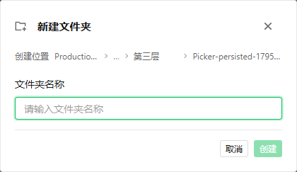
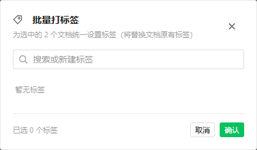
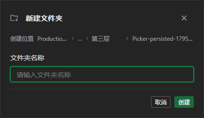
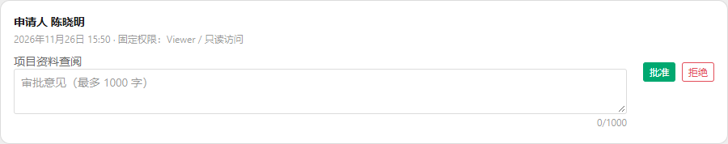

# 目录弹窗一致性与访问申请人用户名（2026-11-27）

## 版本与发布边界

核查时生产APP、Frontend均为61130bc80，main为d22f3583c；internal/frontend/migrations差异为空。见[只读回执](production-version-readonly.json)。本PR中的优化尚未部署生产。下面截图为真实Vue组件的隔离预览，访问申请使用合成数据。

## 统一小型弹窗

目录创建与同一知识库页面的批量标签弹窗共用 `knowledgeCompactDialog.css` 外框，统一宽度、圆角、留白、关闭控件和明暗主题。标题沿用15px层级、16px灰色图标及现有小号操作按钮，使用应用字体与间距令牌；创建位置只作一行辅助层级展示，完整路径保留在提示和辅助标签中。输入框沿用主题的边框、焦点、错误和禁用颜色。展示折叠不改变API提交的父路径。

预览入口加载应用的字体设置、主题覆盖及本地图标资源，避免测试页面默认字体/资源缺失影响评审。批量标签的交互逻辑保留，测试仍验证草稿、保存及忙碌状态。

## 显示申请人用户名

Owner专用的访问申请列表通过一次LEFT JOIN补充 `applicant_name`，来源为现有 `users.username`。只返回姓名字符串，不加载完整用户资料；原 `applicant_user_id` 保留兼容，页面将其作为悬停辅助信息。缺失、已删除用户及旧版API未返回姓名时显示“姓名暂不可用”，避免将UUID当作姓名。审批仍使用申请记录ID。

字段是忽略迁移的只读投影，无新增数据库列或迁移。服务层的目标空间有效Owner门禁保留；跨空间数据、已删除账号姓名、邮箱和密码不进入新增投影。前端按文本渲染用户名。

## 验证

- 前端目录/标签组件、状态及多语言63项，加Portal合同/权限表现回归23项，共86项通过。
- 五项真实浏览器组件测试通过：桌面/窄屏、完整路径键盘提交与pending保护、409错误与恢复、两种主题下与现有弹窗的实际样式对照、用户名/缺失姓名/旧接口回退及安全文本渲染、审批仍按原申请ID提交。
- vue-tsc类型检查与生产构建通过。
- 仓库级姓名投影、删除/缺失账号、跨空间隔离、资料字段排除和无迁移测试（SQLite）通过。Owner服务边界测试也已在断网的bookworm隔离构建容器中通过，确认有效Owner读取姓名及无目标空间成员关系的系统管理员被拒绝。见[测试日志](applicant-owner-tests.txt)和[校验回执](verification.json)。

浏览器UI用例模拟API，不冒充已部署后端验收。原有真实Go/数据库目录持久化用例在PR专用门禁继续运行。Windows和测试主机旧原生C++库无法链接现有DuckDB依赖，未将这些构建失败记为服务测试通过；转由隔离的标准bookworm构建容器复测。未替换主机系统库或生产镜像。
