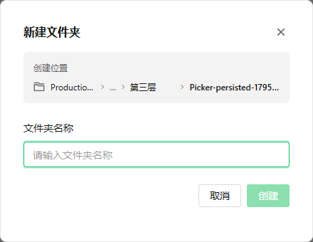

# 新建目录弹窗优化（2026-11-27）

## 版本核查

当前生产APP与Frontend均为61130bc80160853a435aca0d23164ccb46cec2ef、运行正常。当前main为d22f3583c91971648b34bbbec7fd12a506ad4742；两者internal/frontend/migrations差异为空，新增提交为上次发布后的文档、证据与运维预检。不是所有提交号都相同，但目录业务代码一致。见[生产只读回执](production-version-readonly.json)。

## 调整

- 创建位置独立为浅色上下文区域，用内置SVG文件夹图标和层级分隔符展示。超过三级时保留知识库及最后两级，悬停可查看完整路径，辅助技术可读取完整位置。图标不依赖外部CDN。
- 名称输入框明确四边边框、圆角、占位提示及正常/焦点/错误/禁用状态，保留原生label与错误描述关联、自动聚焦和回车提交。
- 标题仍为“新建文件夹”，确认按钮为“创建”；空白名称禁用，提交时锁定表单。创建API仍传递完整原父路径，展示折叠不修改路径。
- 补齐五种语言文案，仅修改前端呈现和测试，无后端或数据库变更。

## 验证边界

本地vue-tsc类型检查通过；目录状态/组件与多语言回归57项通过；3项真实浏览器组件交互测试通过，涵盖1280与375宽度、完整父路径提交、pending防重复、409错误及编辑清除。浏览器新增UI用例使用模拟API；原有真实Go服务/数据库持久化浏览器用例仅更新确认按钮选择器，在PR专用CI继续运行，不能将本地UI用例冒充真实数据库验收。

下图来自真实Vue组件的隔离预览，不是生产部署截图。本次优化未部署生产。

