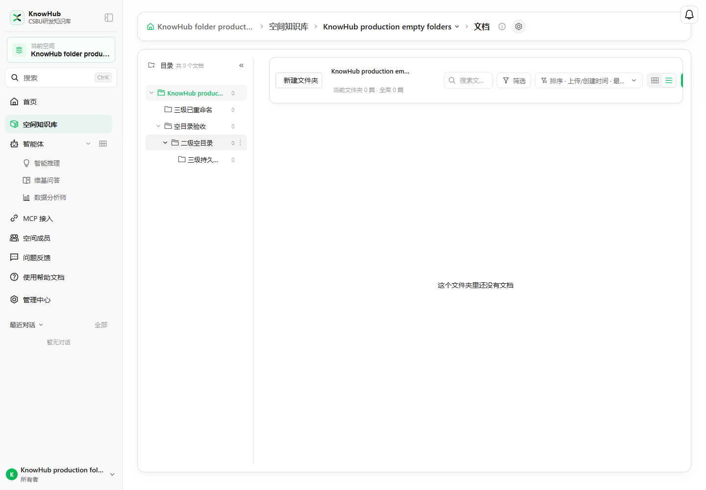
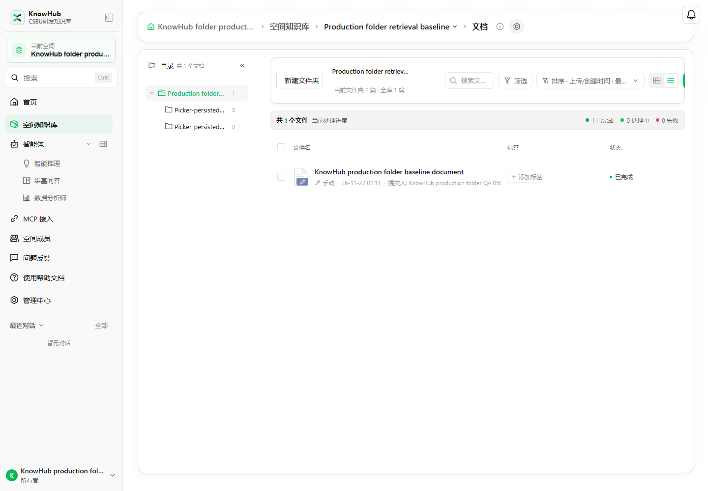
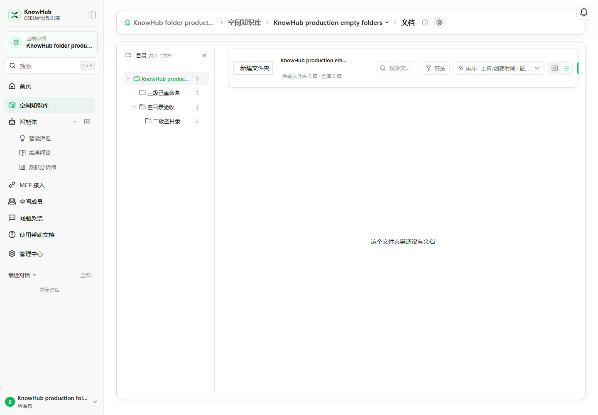

# 多级目录生产发布与实际验收（2026-11-27）

生产已按用户“可以不用备份直接发布吧”及后续“批准临时续期并恢复服务、继续发布”指令发布，公开入口已恢复。发布时最新 main 为 **61130bc80160853a435aca0d23164ccb46cec2ef**；APP、内嵌Worker、Frontend同源，Schema **3052 clean**。测试站点仍为642bbe7f1；不能将测试部署版本误写为本次生产版本。

## PR、CI与不可变版本

- [PR273](https://github.com/suoak/WeKnora/pull/273) 已合并，合并提交 f3573b6f52ca11cdb6eb41cd70623faaf630db3f。全部8检查中5成功、3条件跳过，无失败。
- [PR274](https://github.com/suoak/WeKnora/pull/274) 已合并，产生生产候选61130bc80；全部8检查中5成功、3条件跳过。
- 候选main检查9成功、6条件跳过。目录真实PG/组件/浏览器工作流[45846103456](https://github.com/suoak/WeKnora/actions/runs/45846103456)、来源校验[45846109870](https://github.com/suoak/WeKnora/actions/runs/45846109870)、镜像[45845304365](https://github.com/suoak/WeKnora/actions/runs/45845304365)成功。跳过项不冒充执行通过。
- Docker29生产引擎使用manifest digest作为镜像ID；构建端用config digest。逐字节校验原始manifest/config和全部rootfs层后桥接映射，未重建、改标或覆盖来源。

| 组件 | 生产实际引擎ID | 构建config digest |
|---|---|---|
| APP/Worker | `sha256:4ab0b3ea82462715d1557b1e417e59d1f3e93236abe5f8a3bce5a84a8764ae42` | `sha256:3aba2726b3f8d9b112ea846b6e780c3ec0ba572300cd6a541c7c85e9c1c5c316` |
| Frontend | `sha256:52205d741b73c9dbd6bb165c43ca6cf309272d1b164e9549c21249da874f7305` | `sha256:9fe8f39ab663c630706c99e9f4aca8c001c9d6ee25f3b0b8213aff00a34c661f` |

[完整映射](production-release-evidence/production-runtime-image-resolution.json)、[实际运行与隔离入口](production-release-evidence/production-final-runtime.json)。

## 发布检查清单与真实证据

- [x] 停公开前端写入口，APP通过SIGTERM和既有ResourceCleaner正常排空Worker；无强杀、清锁、任务重放或迁移Force。确认无存活旧Worker租约及数据库APP会话后迁移。
- [x] 新镜像migrate明确执行 `up 1`：3051 clean → 3052 clean，只新增knowledge_folders，历史003048和3051未改写。AUTO_MIGRATE及AUTO_RECOVER_DIRTY保持false。
- [x] 冻结期间迁移前后 **9,571条knowledges、6,636,776条chunks、2,233,809条embeddings、142条sources** 一致；文档全字段摘要、folder_path、sources/models/users/tenants摘要完全一致。此结论限冻结窗口，恢复正常同步后不要求业务行永久不变。[SQL回执](production-release-evidence/production-migration-receipt.json)。
- [x] 正常QA账号仅为新建合成空间10023的owner，无系统管理或全租户权限。目录API35个实际断言通过：三级空目录、空目录改名moved_count=0、移动合并、冲突及安全删除、文档字段稳定、未登录401、跨空间403、retrieve-only key读取200/目录三类写入403。临时MCP Key已删除。[API证据](production-release-evidence/production-api-acceptance.json)。
- [x] 实际浏览器创建三级空目录并刷新、重命名、移动通过；选择器创建目录、移动文档、恢复文档原位置后空目录保留，关键词和向量检索命中原QA文档。[页面](production-release-evidence/production-browser-acceptance.json)、[选择器](production-release-evidence/production-picker-acceptance.json)。选择器首次5秒UI等待超时，后台目录实际存在；调整为30秒后重新完整操作通过，未将首次失败改写为通过。
- [x] 公开生产入口普通QA再次刷新确认三级空目录持久存在、0文档、运行版本611；[最终公开验收](production-release-evidence/production-public-acceptance.json)。
- [x] 所有原挂载、8443策略、证书、数据卷和MCP配置保留。真实TLS校验通过，8443目录POST返回404、未认证Personal MCP返回401；同版无公开端口的预验收前端已移除。
- [x] 新目录表独立归档保全：6行，2645字节，SHA256 `a772acf6bf645a1c0d6a19311e7531ed0042ba9dc76ff8e012a58b5adedcbf9f`，`/mnt/sata0/knowhub-folders-release-61130bc80/knowledge-folders-after-acceptance.dump`。pg_restore --list通过，**此生产归档未实际恢复演练**。[回执](production-release-evidence/production-folder-table-backup.json)。
- [ ] 新生产全库备份、生产全库恢复演练：**用户明确豁免，未执行，不能写通过**。既有备份保留；最新3049归档无完整恢复成功证明，不能充当即时3051恢复点。合成3051→3052和旧repository兼容演练见原准备材料。
- [ ] 完整真实飞书在线同步轮次：**仍未验证**，见下文；源码兼容、受管文档移动拒绝、心跳许可不替代完整同步。

## SID启动故障及授权范围

首次切换APP因既有 `code_flow_tls_userinfo` 策略于北京时间2026-11-26 23:59到期而启动失败；自动回切原镜像也被相同配置到期拒绝，未恢复服务。到期应在停服务前检查，本次漏检造成维护延长，不能描述成成功回滚演练。

用户单独明确批准续期至 **2026-11-28 01:00+08:00**。只修改到期时间与审批引用，保持受控TLS UserInfo策略、issuer、来源和其余权限不变。新APP随后原生启动健康，前端验收后开放。没有启用continuous_test、关闭TLS/签名策略、伪造会话或绕过安全锁。此期限到达前需按正式安全流程完成长期策略或另行审批，**本次授权不允许自动再次续期**。

## 已验证兼容项 / 尚未验证的在线同步项

已验证兼容：目录核心与飞书安全控制路径没有扩大权限；受管文档目录移动测试仍受PR188锁/003048限制；保留folder_path兼容和检索；正常停机使用既有drain/fence保护。生产重启后namespace独立、trip=false、permit正、一个真实新Worker身份及有效租约，sync/approved_sync无安全暂停。

尚未验证：测试环境legacy-feishu的历史registry_redis_timeout停止仍保留，当前恢复流程不适配其双Worker/归档任务/缺恢复公钥条件，未擅自恢复。[完整独立诊断](sync-incident-20261126.md)。

生产自然调度观察期间approved_sync归档从22增至23。只读解析最近任务元数据得到 **feishu controller not ready / ERR SYSTEM_CANARY_OTHER_SOURCE**（重试5次），对应既有automatic_service_sources.go中canary绑定来源及run不匹配时的拒绝；未触发生产trip。不能据此认为完整同步通过，也不能直接归因于目录迁移。[实际错误回执](production-release-evidence/production-natural-sync-observation.json)。只读保留现有来源范围，不扩Canary、不重放归档。错误字段来自Asynq TaskMessage字段7，依据[上游proto定义](https://github.com/hibiken/asynq/blob/master/internal/proto/asynq.proto)，未导出任务payload或凭据。

补充自然观察（北京时间01:22—01:23）：生产控制已进入 **normal**，trip=false、permit和真实Worker租约持续正常。[控制回执](production-release-evidence/production-final-observation.json)。数据库4个既有飞书来源在重启后更新了成功同步时间，total/created/updated/failed均为0、cursor存在，见[仅元数据SQL回执](production-release-evidence/production-natural-sync-success-observation.json)。这是**零变更增量轮次完成**的证据，不代表非空新文档抓取→发布→检索完整链路通过；新legacy attempts另有3个staging、1个obsolete，不冒充published。期间approved_sync归档累计25，既有归档未重放；历史错误与后续normal状态都保留，不以最终状态抹去失败。

## 回滚、数据保全与发布判断

本次是带明确备份豁免和在线同步限制的受限发布，目录/权限/检索实际验收通过、公开服务恢复；**不是全部验收项无条件完成**。未获即时3051全库恢复点，若发生数据层事故，将无法保证无损全库回退。新目录表独立归档仅保护目录标记，不保护其他业务数据。

优先仅回切原始兼容代码镜像，保留Schema3052及knowledge_folders，禁止migration down、Force或恢复旧库覆盖新业务写入。生产私有 `/home/aqyfzx/knowhub-folders-release-61130bc80/rollback-compose.json` 已保存原始镜像、保护挂载和用户批准的SID到期；文件0600、目录0700。候选及原镜像均保留。旧前端可能暂不显示空目录，目录数据继续保留。

**61130bc80版通用rollback脚本不能直接当成本次执行命令**：它默认新做全库备份且缺少Docker29 engine/manifest身份适配。本收尾PR已新增严格来源/config/manifest/层映射和SID至少15分钟有效期预检；真实POSIX十四项测试、bash语法及无操作dry-run通过。[实际生产只读预检](production-release-evidence/production-rollback-preflight-only.json)也确认原镜像、映射、SID、挂载、额外写进程和备份容量通过，未停服务或执行回滚。

所需四份私有元数据已同样保全至 `/mnt/sata0/knowhub-folders-release-61130bc80`，库49.25GB、该盘可用105.75GB，[材料回执](production-release-evidence/production-rollback-materials.json)。新脚本仍要求回滚时新做全库和目录表备份，本次发布豁免不会自动扩展至未来回滚。

完整回退入口为本收尾PR经CI的 `CONFIRMED_ROLLBACK_RELEASE_SHA=61130bc80160853a435aca0d23164ccb46cec2ef bash scripts/ops/rollback_knowledge_folders.sh --execute /mnt/sata0/knowhub-folders-release-61130bc80`。脚本会安全拒绝在途工作/空间不足/策略到期等不满足条件的现场，不自动解除安全停止。以下列出同一私有配置的底层代码回退入口；需另开维护窗口、检查SID有效、原镜像存在、正常排空Worker并保全当时数据后才执行，不能粘贴绕过检查：

```bash
# 检查，不打印任何环境变量或凭据。
docker image inspect sha256:41ded77264df8097a6d7641f3e87ae07e2809cdd57ada72d1a2539b079395967 >/dev/null
docker image inspect sha256:00eecab6b8ccf5808beab525254a0f308bc0d4c71ac7297151ab5d041249aa2e >/dev/null
# 写入口维护后，走正常SIGTERM drain，禁止强杀、清锁或重放。
docker stop --time -1 WeKnora-frontend
docker stop --time -1 WeKnora-app
# 必须先只读确认租约/在途工作已排空且Schema3052 clean；否则保留现场，停止执行。
# 保存当时目录表、核对恢复材料和SID有效期后，才允许：
docker compose --project-directory /home/aqyfzx/knowhub-folders-release-61130bc80   -p release-package -f /home/aqyfzx/knowhub-folders-release-61130bc80/rollback-compose.json   up -d --no-deps --no-build --pull never app frontend
# 原生健康、认证、检索、隔离入口及既有飞书控制重新验收后才能结束维护。
```

没有执行上述最终回退；旧代码repository在3052真实PG兼容已通过，但旧原生APP在批准续期后的完整启动没有演练，不能承诺无条件回退成功。需要数据库恢复时另行审批，在生产侧隔离新库恢复并对比差异，禁止将生产Canary或生产业务数据移植至测试站点。

## 页面截图




